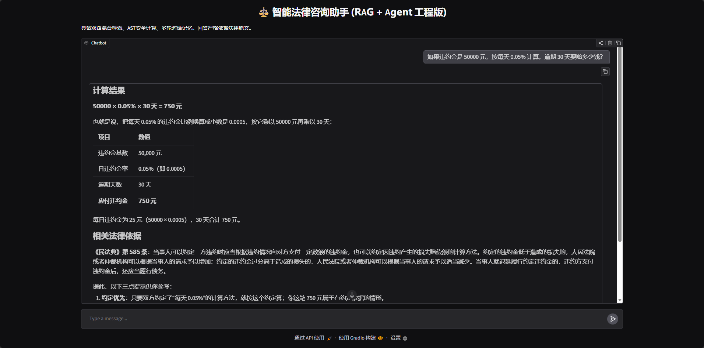
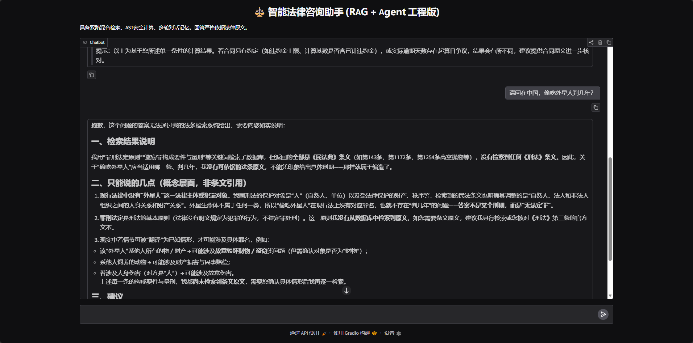

# ⚖️ 智能法律咨询助手 (RAG + Agent 工程版)

基于 LangChain v1、FAISS 和通义千问构建的新一代智能法律咨询系统。具备多步推理、双路混合检索、高安全性工具调用等工业级特性。

## ✨ 核心特性 (Features)

- **Agent 多步推理 (ReAct)**：集成 `create_agent`，LLM 可自主判断调用 `Law_Search`（法条检索）或 `Calculator`（金额计算），实现复杂问题（如违约金计算+法条溯源）的全自动闭环。
- **双路混合检索 (Hybrid RAG)**：采用 `FAISS 向量检索` + `BM25 关键词检索`，通过 `EnsembleRetriever` 融合，解决法律术语精确匹配与语义召回的双重痛点。
- **高安全性防护**：弃用原生 `eval()`，基于 Python `ast` 模块实现白名单安全求值器，彻底杜绝 Agent 工具调用时的 Prompt 注入与 RCE（远程代码执行）漏洞。
- **冷启动极速优化**：实现 FAISS 索引本地持久化（`save_local`/`load_local`），二次启动无需重新向量化，加载速度提升 90%。
- **工程化架构**：全分离式模块设计（配置、数据、工具、核心逻辑、UI），支持 `.env` 敏感信息隔离，内置 API 429 限流退避重试机制，适配 Gradio 新版多轮对话 Memory。

## 🎬 效果演示

### 1. 多步推理与精准计算 (RAG + Agent)

> **场景描述**：Agent 自动识别用户意图，先调用 `Calculator` 工具完成违约金计算，再调用 `Law_Search` 工具检索《民法典》关于违约金的法律条文，最后综合生成专业解答。

### 2. 知识边界外精准拒答 (防幻觉测试)

> **场景描述**：面对“偷吃外星人”这种知识库外的荒谬问题，Agent 不会胡编乱造，而是严格依据“罪刑法定原则”，结合检索结果与自身常识，给出合理的拒答与法理分析。

## 🛠️ 技术栈

- **大语言模型**：通义千问 (`qwen-turbo` / `deepseek-v4.1-flash` 等 OpenAI 兼容模型)
- **Agent 框架**：LangChain (v1.x), LangChain-Core, LangChain-Community
- **检索增强 (RAG)**：FAISS, Rank-BM25
- **Embedding**：BAAI/bge-small-zh-v1.5 (本地离线部署)
- **前端交互**：Gradio

## 🚀 快速开始

### 1. 安装依赖
```bash
pip install -r requirements.txt