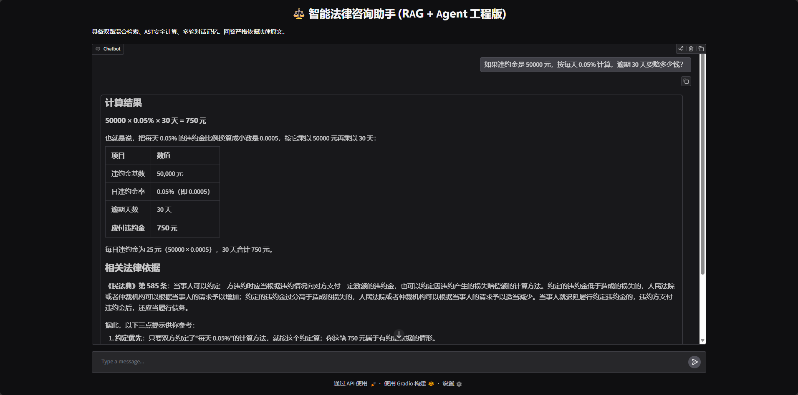
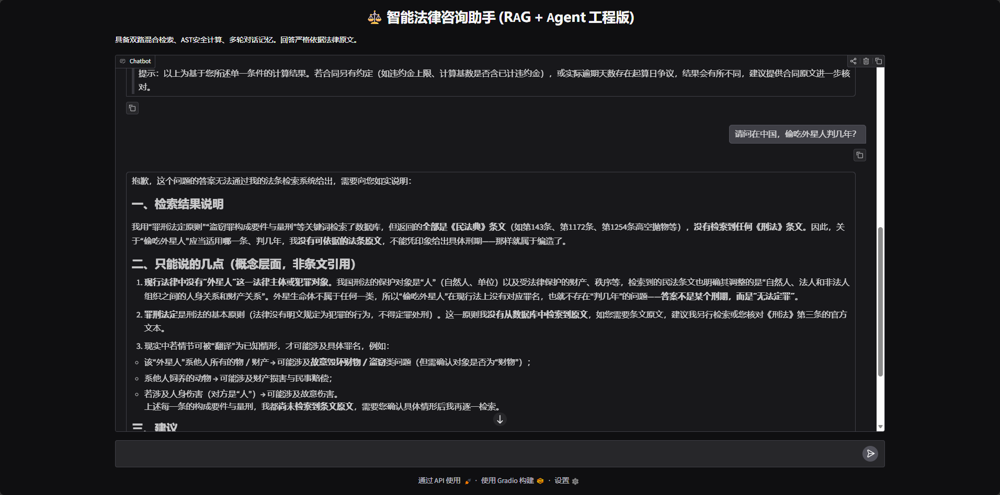

# ⚖️ 智能法律咨询助手 (RAG + Agent 工程版)

基于 LangChain v1、FAISS 和通义千问构建的新一代智能法律咨询系统。具备多步推理、双路混合检索、高安全性工具调用等工业级特性。

## ✨ 核心特性 (Features)

- **Agent 多步推理 (ReAct)**：集成 `create_agent`，LLM 可自主判断调用 `Law_Search`（法条检索）或 `Calculator`（金额计算），实现复杂问题（如违约金计算+法条溯源）的全自动闭环。
- **双路混合检索 (Hybrid RAG)**：采用 `FAISS 向量检索` + `BM25 关键词检索`，通过 `EnsembleRetriever` 融合，解决法律术语精确匹配与语义召回的双重痛点。
- **高安全性防护**：弃用原生 `eval()`，基于 Python `ast` 模块实现白名单安全求值器，规避 Agent 工具调用时的注入风险（仅允许四则运算与幂，拒绝属性访问与函数调用）。
- **冷启动优化**：实现 FAISS 索引本地持久化（`save_local`/`load_local`），二次启动无需重新向量化（已知优化点：BM25 语料目前仍会重新切块，见「已知局限」）。
- **工程化架构**：全分离式模块设计（配置、数据、工具、核心逻辑、UI），支持 `.env` 敏感信息隔离，内置 API 429 限流退避重试机制，适配 Gradio 新版多轮对话 Memory。

## 🎬 效果演示

### 1. 多步推理与精准计算 (RAG + Agent)

> **场景描述**：Agent 自动识别用户意图，先调用 `Calculator` 工具完成违约金计算，再调用 `Law_Search` 工具检索《民法典》关于违约金的法律条文，最后综合生成专业解答。

### 2. 知识边界外精准拒答 (防幻觉测试)

> **场景描述**：面对“偷吃外星人”这种知识库外的荒谬问题，Agent 不会胡编乱造，而是严格依据“罪刑法定原则”，结合检索结果与自身常识，给出合理的拒答与法理分析。

## 🛠️ 技术栈

- **大语言模型**：通义千问 (`qwen-turbo` / `deepseek-v4.1-flash` 等 OpenAI 兼容模型)
- **Agent 框架**：LangChain (v1.x), LangChain-Core, LangChain-Community
- **检索增强 (RAG)**：FAISS, Rank-BM25
- **Embedding**：BAAI/bge-small-zh-v1.5 (本地离线部署)
- **前端交互**：Gradio

## 🚀 快速开始

### 1. 安装依赖
```bash
pip install -r requirements.txt
```

### 2. 配置密钥
```bash
cp .env.example .env      # 填入 DASHSCOPE_API_KEY
```
程序在 `config.py` 中校验，缺失会直接报错，避免把 Key 写进代码。

### 3. 运行
```bash
python database.py     # 首次运行：切块 + 建 FAISS 索引并落盘（之后直接加载）
python app.py          # 启动 Gradio 界面（127.0.0.1:7860）
```

### 4. 目录结构
```
LawAgent-Pro/
├─ app.py           # Gradio 界面与多轮对话
├─ agent_core.py    # LLM 初始化 + Agent 组装（create_agent）
├─ tools.py         # 两个工具：Law_Search（混合检索）、Calculator（AST 安全求值）
├─ database.py      # 文档加载 / 切块 / FAISS 持久化 / BM25 + 向量混合检索
├─ config.py        # 环境变量与模型配置
├─ law.txt          # 语料（《民法典》1260 条）
└─ vectorstore/     # 本地索引（gitignore）
```

## ⚠️ 已知局限

1. **没有量化评测**：目前靠人工看几条 case 判断效果，没有金标集，也没有 Recall@k / MRR。这是下一步的首要工作。
2. **BM25 每次启动重建**：FAISS 已持久化，但 BM25 仍需重新切块，冷启动未被完全优化。
3. **工具调用是单轮的**：`create_agent` 未做显式编排，无法观测中间步骤，也没有重试/回退策略。
4. **只有 Gradio**：适合演示，不适合作为产品形态（无鉴权、无限流、无会话持久化）。
5. **语料仅《民法典》**：刑法、劳动法等领域未覆盖，跨法域问题会答不上来。
6. **`allow_dangerous_deserialization=True`**：FAISS 的 pickle 加载方式只在"索引由本人生成"时安全，生产环境应换安全格式或校验来源。

## 🗺️ Roadmap

- [ ] 50 题金标集 + Recall@k / MRR 评测脚本
- [ ] Agent 换成 LangGraph 显式编排（路由 → 检索 → 校验 → 回答）
- [ ] FastAPI 服务化：SSE 流式 + 会话落库 + 引用溯源前端
- [ ] 工具改用 `@tool` / StructuredTool + Pydantic 参数校验
